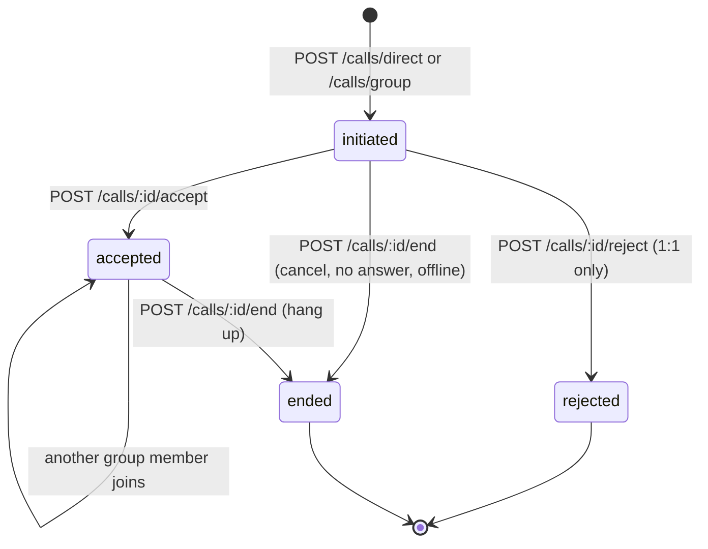
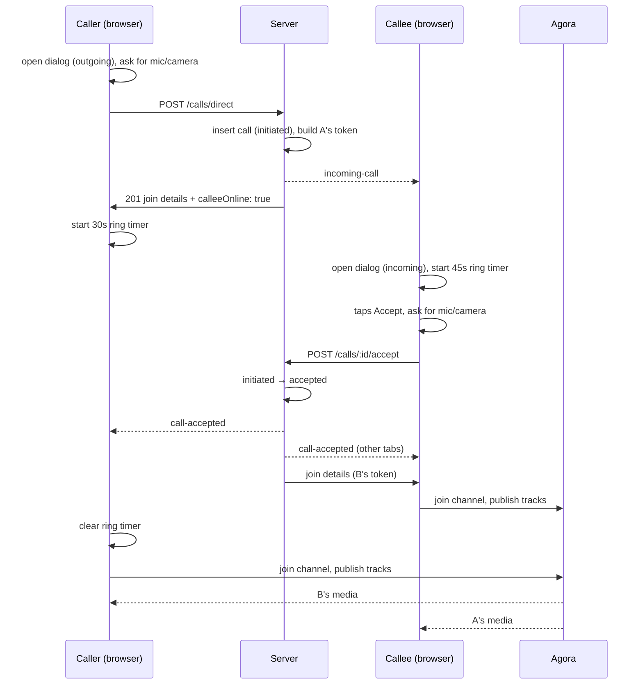
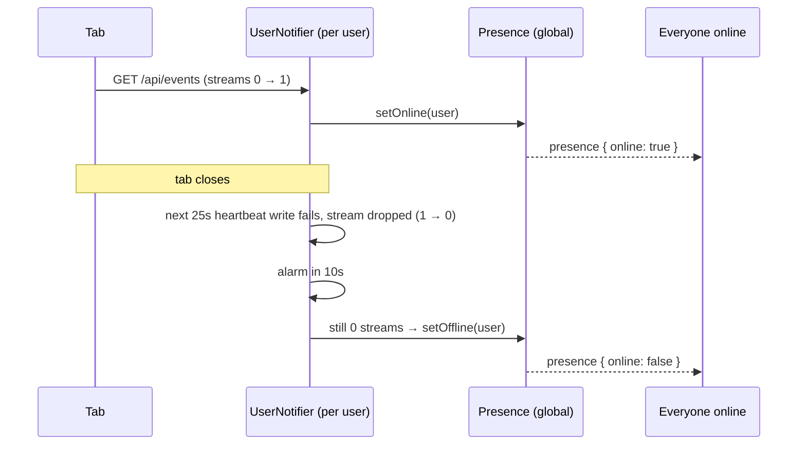

# Call flows

How calling works in this app, end to end: who talks to whom, what changes in the
database, and what each person sees. Diagrams are Mermaid (they render on GitHub
and in VS Code's Markdown preview).

> Snapshot of the code as of 2026-10-31. If something here disagrees with the
> code, the code wins.

## Contents

- [The moving parts](#the-moving-parts)
- [Call status](#call-status)
- [Server events (SSE)](#server-events-sse)
- [1:1 calls](#11-calls)
  - [Answered](#answered)
  - [Declined](#declined)
  - [Caller cancels while ringing](#caller-cancels-while-ringing)
  - [No answer](#no-answer)
  - [Callee is offline](#callee-is-offline)
  - [Callee is busy](#callee-is-busy)
  - [Callee has several tabs open](#callee-has-several-tabs-open)
  - [Hanging up](#hanging-up)
  - [Mic or camera permission denied](#mic-or-camera-permission-denied)
- [Group calls](#group-calls)
- [Presence (online dots)](#presence-online-dots)
- [Timers](#timers)
- [Known gaps](#known-gaps)

## The moving parts

| Piece | Where | Job |
|---|---|---|
| Call API | [src/routes/calls.ts](../src/routes/calls.ts) | Creates calls, moves them between statuses, issues Agora tokens, sends events |
| `calls` table | [src/db/schema.ts](../src/db/schema.ts) (D1) | One row per call: type, media, Agora channel, caller, callee or group, status |
| `UserNotifier` Durable Object | [src/durable-objects/user-notifier.ts](../src/durable-objects/user-notifier.ts) | One per user. Holds their open SSE streams (one per tab) so the server can push events to them |
| `Presence` Durable Object | [src/durable-objects/presence.ts](../src/durable-objects/presence.ts) | One global instance. The set of online user ids |
| Call client | [src/client/calls.ts](../src/client/calls.ts) | Loaded on every signed-in page. Listens for events, drives the call dialog, joins Agora |
| Call dialog | [src/components/call-dialog.tsx](../src/components/call-dialog.tsx) | The ringing / in-call UI |
| Agora | external | Carries the actual audio and video. The server only hands out tokens |

The server never touches media. It does signalling only: "X is calling you",
"they answered", "it's over". Once both sides have join details they talk to
Agora directly.

```mermaid
flowchart LR
  subgraph Browser A
    CA[calls.ts]
  end
  subgraph Browser B
    CB[calls.ts]
  end
  subgraph Worker
    API[/api/calls/*]
    EV[/api/events]
  end
  DB[(D1: calls)]
  UNA[UserNotifier A]
  UNB[UserNotifier B]
  P[Presence]
  AG((Agora))

  CA -- POST --> API
  API -- read/write --> DB
  API -- notify --> UNB
  CB -- EventSource --> EV --> UNB
  UNB -- SSE events --> CB
  UNA -. online/offline .-> P
  UNB -. online/offline .-> P
  CA <-- audio/video --> AG <-- audio/video --> CB
```

## Call status

Stored in `calls.status`. Every change goes through `transition()`, a single
conditional `UPDATE ... WHERE status IN (...)`. If two requests race (say,
accept and cancel at the same moment) only one wins; the loser gets a `409`.



Note there is no `missed` status. An unanswered call ends up as `ended`, the
same as a call that connected and then hung up.

## Server events (SSE)

Each signed-in tab opens `GET /api/events`, which is routed to that user's
`UserNotifier`. Events the server sends:

| Event | Payload | Sent to | Sent when |
|---|---|---|---|
| `incoming-call` | `callId, type, media, caller, group?` | Callee (1:1) or every other group member | A call is placed |
| `call-accepted` | `callId, by` | Caller, and the callee's own tabs (1:1) / caller only (group) | Someone answers |
| `call-rejected` | `callId` | Caller and the callee's own tabs | 1:1 callee declines |
| `call-ended` | `callId` | The other party (1:1) / every other member (group) | Someone ends the call |
| `presence` | `userId, online` | Everyone online | A user comes online or goes offline |

`notifyUser()` returns how many streams the event reached. `0` means the user
has no tab open, which is how the server knows a callee is offline.

## 1:1 calls

Placed from the **Call** / **Video** buttons on the users page. The caller sees
their dialog as "outgoing", the callee as "incoming".

### Answered



The caller asks for mic/camera access **while it rings**, so the permission
prompt is out of the way by the time the callee answers.

### Declined

1. Callee taps **Decline**. Their dialog closes immediately.
2. `POST /calls/:id/reject` → `initiated → rejected`.
3. Server sends `call-rejected` to the caller and to the callee's other tabs.
4. Caller sees **"*Name* declined the call"**. Callee's other tabs close quietly.

### Caller cancels while ringing

1. Caller taps **Hang up**.
2. `POST /calls/:id/end` → `initiated → ended`.
3. Server sends `call-ended` to the callee.
4. Callee sees **"Missed call from *Name*"**.

If the caller cancels before `POST /calls/direct` has even returned, the client
sends `/end` as soon as the call id arrives, so the callee still stops ringing.

### No answer

1. The caller's 30s ring timer fires → caller sees **"*Name* didn't answer"**.
2. `POST /calls/:id/end` → `initiated → ended`.
3. Callee gets `call-ended` → sees **"Missed call from *Name*"**.

Backup: if the callee never gets that event (e.g. the caller's tab died), the
callee's own 45s timer closes their dialog with the same "Missed call" message.
That backup is local only; it doesn't change the database.

### Callee is offline

1. `POST /calls/direct` inserts the call, but `incoming-call` reaches 0 streams,
   so the response has `calleeOnline: false`.
2. Caller immediately sees **"*Name* isn't online right now"** and calls `/end`
   → `initiated → ended`.
3. The callee is never told, now or later.

### Callee is busy

The callee is already in a call (any call, ringing or connected):

1. Their client auto-sends `POST /calls/:id/reject` → `initiated → rejected`.
2. Callee sees a toast: **"Missed a call from *Name* while busy"**.
3. Caller sees **"*Name* declined the call"** (it doesn't say "busy").

The reject can arrive at the caller *before* the response to `POST
/calls/direct`, while the caller doesn't know the call id yet. The client keeps
these in `settledEarly` and checks it when the id arrives.

### Callee has several tabs open

Every tab rings. The server sends `call-accepted` / `call-rejected` to the
callee's own streams too, so:

- Answer in one tab → the others close with **"Answered in another tab"**.
- Decline in one tab → the others close quietly.

### Hanging up

Any of these ends a connected 1:1 call (`accepted → ended`, other side sees
**"Call ended"**):

| Trigger | How |
|---|---|
| Either side taps **Hang up** | `POST /calls/:id/end` |
| Either side closes or leaves the page | `pagehide` handler sends `/end` with `navigator.sendBeacon` |
| The other side drops out of Agora (crash, lost network) | Agora's `user-left` fires, the remaining side hangs up |

Whoever ends it second gets a `409 Call is not active`, which is ignored.

Pressing Escape doesn't close the dialog, so you can't accidentally leave a call
running with no UI.

### Mic or camera permission denied

1. `getUserMedia` rejects with `NotAllowedError`.
2. The client hangs up (`/end`), so the other side stops ringing or sees "Call ended".
3. The user sees an error toast: **"Camera or microphone access is blocked..."**
   with the original error name and message appended. The full error and stack
   are logged to the console as `Media access blocked:`.

## Group calls

Started from the **Call** / **Video** buttons on each group under *Your groups*
on the groups page. Groups you're not in have no call buttons, and the buttons
are disabled when you're the only member. The server enforces both rules either way.

| Step | What happens |
|---|---|
| Start | `POST /calls/group` (caller must be a member, group must have someone else in it). Insert call (`initiated`), send `incoming-call` with `group` to every other member. Response includes `membersOnline`; if it's 0 the caller hangs up with "No one else in *Group* is online right now" |
| Ringing | Like a 1:1 call, the caller rings until the first member joins (`call-accepted`), then joins the channel. After 30s with no one joining, the caller ends the call ("No one in *Group* answered") |
| Join | Any member (not the caller) taps Accept → `POST /calls/:id/accept` → status becomes/stays `accepted`. Only the caller gets `call-accepted`. Members can keep joining while the call is live |
| Decline | Local only. The dialog closes, nothing is sent, the call carries on for everyone else |
| Leave | A member who hangs up just leaves Agora. The call stays `accepted` |
| End | Only the caller can end it: `POST /calls/:id/end` → `ended`, and every other member gets `call-ended` |

Members' dialogs show "*Group* (*Caller*)" as the title.

## Presence (online dots)

A user is **online** while they have at least one `/api/events` stream open,
i.e. any signed-in tab. Shown as a green dot on the users page avatars.



- **10s grace period**: pages are server-rendered, so every click closes the
  stream and opens a new one. Without the grace period people would flicker
  offline on every navigation.
- **60s check while online**: an alarm re-checks the streams. If the
  `UserNotifier` restarts (e.g. a deploy) and the user never reconnects, this is
  what marks them offline.
- Going offline after closing the last tab takes up to ~35s (heartbeat + grace).
- The users page renders with the current set, then updates live from
  `presence` events. You always show as online to yourself.

## Timers

| Timer | Value | Where | Effect |
|---|---|---|---|
| Caller ring | 30s | client | Hangs up with "didn't answer", ends the call on the server |
| Callee ring | 45s | client | Closes the dialog with "Missed call". Local only |
| SSE heartbeat | 25s | `UserNotifier` | Keeps proxies from closing idle streams; detects dead ones |
| Offline grace | 10s | `UserNotifier` | Delay before marking a user offline |
| Online check | 60s | `UserNotifier` | Catches users left "online" after a restart |
| Agora token TTL | 1h | server | Tokens expire after an hour; long calls aren't renewed yet |
| Toast | 4s | client | How long messages stay on screen |

## Known gaps

- **Ring timeout is client-side.** If the caller's tab dies while ringing, the
  call stays `initiated` forever. Fix: a server-side alarm that ends unanswered
  calls.
- **No missed-call record.** Missed calls are only a 4s toast. Offline callees
  never find out, and the database can't tell missed from finished calls. Fix:
  a `missed` status (plus a `seenAt`), a missed-calls badge/list, and a
  `call-missed` event.
- **Busy looks like declined** to the caller.
- **Callee closing the tab while ringing** doesn't reject; the caller rings
  until their 30s timeout.
- **Group calls**: if the caller leaves without ending it (and `sendBeacon`
  fails) it stays `accepted`. The caller stays in the channel after everyone
  else leaves, until they hang up.
- **Token expiry**: calls longer than an hour will lose their Agora connection.
- **Presence**: a change that happens between the users page rendering and its
  SSE stream opening is missed until the next change or a refresh.
